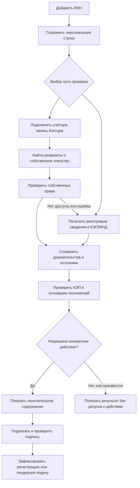

# Компания по ИНН и юридические полномочия: Контур.Диадок и КЭП/МЧД

## Вывод и границы проверки

Сценарий технически реализуем: пользователь Форума добавляет ИНН, сервер получает реквизиты компании и проверяет основание для действий от её имени. Диадок используется как один из источников: при выборе этого пути пользователь подключает собственную учётную запись Контура, а сервер проверяет его права в ящике. Для первого подключения нужен интерактивный вход; при действующем подключении повторная проверка может проходить без нового входа. ИНН сам по себе не подтверждает доступ.

Уточнённый владельцем объём первого релиза: юридически значимое право **регистрировать компанию на площадке** и **подавать заявки/предложения на участие в тендере**. Проверка КЭП и основания представительства входит сразу. Тендерные документы подписываются как документы Форума; их обязательная отправка контрагентам через Диадок не является требованием.

Диадок предоставляет данные своей системы ЭДО. Его API не обещает полное досье компании или исчерпывающий реестр всех её юридических представителей. Права сотрудника на документы, администрирование ящика, полномочия представителя и локальные права Форума имеют разную семантику. [Organization](https://developer.kontur.ru/doc/diadoc-api/proto/Organization.html), [EmployeePermissions](https://developer.kontur.ru/doc/diadoc-api/proto/EmployeePermissions.html), [МЧД](https://developer.kontur.ru/doc/diadoc-api/instructions/powerofattorney.html).

Владелец выбрал допуск по КЭП/МЧД также **без Диадока**. Оба пути входят в первый релиз и сходятся на общей юридической проверке. Отсутствие членства, блокировка в ЭДО, отсутствие API-подписки или сбой Диадока не доказывают отсутствие юридического полномочия и не блокируют независимый путь. Обязательная локальная блокировка Форума сохраняется. Для пути без Диадока нужны подтверждённые источники реквизитов/реестрового основания, актуального статуса МЧД и средство КЭП; их технические и коммерческие контракты выбираются до реализации.

Документ — план исследования, подключения и реализации. Код не изменён; приложение в Контуре не зарегистрировано; ключи не получены; письма и заявки не отправлены; реальная интеграция не проверена. Для запуска выдачи полномочий остаются явные решения ниже.

## Требования из запроса

- R1. Сохранить поток «Личный кабинет → Мои организации → Добавить → ИНН → Добавить».
- R2. Получить доступные реквизиты найденной компании с указанием источника и времени проверки.
- R3. При подключении Диадока проверить собственные права пользователя в конкретной компании/ящике.
- R4. Привязать результат к вошедшему пользователю Форума, а не к общей технической учётной записи.
- R5. Описать возможность получения списка сотрудников и ограничения его доступа.
- R6. Подготовить порядок получения интеграционного доступа, тестовую матрицу и обращения в Контур.
- R7. Ошибки, блокировки, неизвестные поля и устаревшее доказательство не должны выдавать новые права.
- R8. Подтверждение компании не включает автоматически статус исполнителя/заказчика и бизнес-участника.
- R9. Раздельно подтвердить юридические полномочия на регистрацию компании и на подачу заявки/предложения; проверить КЭП, МЧД при представительстве и подпись неизменного содержания действия.
- R10. Разрешить оба юридических действия по независимо проверенным КЭП и полномочиям без учётной записи, членства, ящика или API-подписки Диадока.

## Что доступно в API

| Нужная информация | Источник | Ограничение |
|---|---|---|
| Поиск по ИНН, уточнение по КПП | `GetOrganizationsByInnKpp` | ИНН может вернуть несколько записей; найденная компания не доказывает доступ пользователя |
| Наименование, ИНН/КПП, ОГРН, адрес, подразделения, идентификаторы ЭДО и ящика | `Organization` | Часть полей необязательна; полноту нельзя гарантировать |
| Компании подключившегося пользователя | `GetMyOrganizations` | Требуются проверка `IsEmployee` и отдельная проверка блокировки |
| Текущий пользователь Диадока | `GetMyUser (V2)` | Это учётная запись провайдера, не доказанное равенство личности профилю другого провайдера |
| Собственные права в компании | `GetMyEmployee` | Администрирование, действия с документами, доступ к подразделениям и ограничения |
| Сотрудники компании и их права | `GetEmployees` | Только администратор; постраничная выдача; включает ещё не зарегистрированных сотрудников |
| Доверенности и связанные полномочия | Методы МЧД | Отдельный процесс проверки конкретного действия, представителя, срока и статуса доверенности |
| Финансы, учредители, все банковские счета, полный кадровый состав, все представители вне Диадока | В рассмотренных структурах такого полного набора нет | При необходимости — отдельный источник и отдельная задача |

Источники: [поиск по ИНН](https://developer.kontur.ru/doc/diadoc-api/http/GetOrganizationsByInnKpp.html), [данные организации](https://developer.kontur.ru/doc/diadoc-api/proto/Organization.html), [собственные организации](https://developer.kontur.ru/doc/diadoc-api/http/GetMyOrganizations.html), [текущий пользователь](https://developer.kontur.ru/doc/diadoc-api/http/GetMyUser.html), [собственный сотрудник](https://developer.kontur.ru/doc/diadoc-api/http/GetMyEmployee.html), [сотрудники](https://developer.kontur.ru/doc/diadoc-api/http/GetEmployees.html).

Не трактовать `IsActive` как юридический статус действующей компании: это активность в Диадоке. `HasCertificateToSign` относится к наличию сертификата у организации; `IsOwner` — к владельцу организации среди интеграторов. Эти поля не дают пользователю Форума полномочий. Устаревшие поля не включать в обязательный контракт.

Сотрудники Диадока и участники Форума — отдельные списки. Получение внешнего списка не создаёт локальные аккаунты, приглашения или членства. Для проверки добавляющего пользователя массовое получение сотрудников не требуется.

## Основание в текущем Форуме

Исходное исследование выполнено на `main`, HEAD `29f1d20d2256eb7c28a4c81d29dba5172fdecea0`; индекс GitNexus `ast-forum` соответствует этому коммиту. Во время подготовки документа общая рабочая копия переключилась на `codex/PROJ-170-login-option-1` с тем же HEAD и посторонними правками auth UI. Эти правки не изменялись. Это подтверждение локального кода, не состояния dev/production.

- `apps/web/src/home/Organizations.tsx`: рабочая форма и таблица «Мои организации» на Primer.
- `apps/api/src/organizations/organizations.controller.ts`, `organization-store.ts`, `inn.ts`: GET/POST `/api/me/organizations`, проверка ИНН, идемпотентное персональное добавление.
- `apps/api/migrations/007_my_organizations.sql`: `organization_additions`, уникальность `(user_id, inn)`; добавление возвращает `pending`, без корпоративных прав.
- `apps/api/migrations/006_person_memberships.sql`: независимые аккаунт, организация, членство, authority и бизнес-контекст.
- `apps/api/src/party/business-access.ts`: действующая проверка бизнес-доступа.
- `apps/api/src/iam/auth-store.ts`, `auth.controller.ts`, `apps/api/src/config.ts`: существующий вход и сессия; реализованного клиента Диадока нет.
- `apps/dev-gateway/forum_dev_auth.py`: allowlist маршрутов, который потребуется расширить.
- `deployment/forum-api/grant-runtime.sql`: runtime пока не имеет права записывать организационное членство/authority.

Действующего модуля тендерных заявок/предложений, его API и таблиц нет. `docs/plans/2026-09-18-procurement-mvp-plan.md` исторический и не задаёт готовый контракт. Поэтому интеграция создаёт проверяемый контракт полномочий и подписи; применение его при подаче требует реализации или согласованного плана самого тендерного модуля. Полноценная подача предложения не появится от одного подключения Диадока.

Основы: [PROJ-161](2026-10-09-PROJ-161-person-memberships.md) и [PROJ-162](2026-10-09-PROJ-162-my-organizations.md). [Историческое исследование](2026-08-14-external-identity-feasibility.md) содержит вопрос D0 о первом администраторе. Его технические факты перепроверены по текущим официальным источникам.

В памяти сохранена страница [IAM.02](https://docs.astforum.ru/doc/iam0102-rolevaya-model-VbZ7MBWv2A), опубликованная 02.10.2026. Её текущее содержимое и статус решений сегодня не проверялись. Перед реализацией перечитать под «Кузьмина» и согласовать с планом.

Утверждения старых `2026-08-14-module-boundaries-and-data-ownership.md` и `2026-08-14-postgresql-data-model.md` об автоматическом личном исполнителе и отсутствии pending-состояний заменены поздними требованиями PROJ-161/162. Отменённый парсер PR №2 не относится к этой интеграции.

## Пользовательский поток

1. Пользователь добавляет ИНН. Сохраняется собственная строка, даже если внешний источник временно недоступен.
2. Пользователь выбирает «Подключить Диадок» либо «Подтвердить полномочия КЭП». Второй путь не требует входа в Контур или создания ящика ЭДО. При действующем подключении Диадока сервер может начать сбор его сведений сразу после добавления; юридическое подписание всё равно требует явного действия.
3. В пути Диадока Контур возвращает авторизацию на зарегистрированный callback. Попытка связана с пользователем, сессией, собственным добавлением и ИНН. Сервер получает текущую учётную запись и собственные организации, уточняет КПП/ящик по проверенным кандидатам и получает собственные права только существующего сотрудника. Поиск по ИНН используется для реквизитов, не для доказательства доступа.
4. В независимом пути сервер получает реквизиты/реестровое основание из согласованного источника ЕГРЮЛ/ЕГРИП, а пользователь предъявляет КЭП и, при представительстве, идентификатор/подписанный файл МЧД. Статус и содержимое МЧД проверяются через согласованный реестр/оператора, а не через обязательное назначение доверенности сотруднику Диадока.
5. Доказательства сохраняются с источником, временем и результатом. Ошибка или отсутствие доступа к Диадоку позволяют перейти к независимой проверке. Неуспех технического источника не превращается в юридический отказ; неизвестное юридическое основание не выдаёт права.
6. Общая проверка связывает подписанта с текущим аккаунтом через владение КЭП и подтверждает основание представительства. Для представителя проверяется подходящая МЧД; для лица, действующего без доверенности, — самостоятельное реестровое основание. Положительная проверка прав Диадока этого не заменяет.
7. Пользователь просматривает и подписывает регистрационное заявление. Сервер принимает юридическую регистрацию и отдельно оценивает выдачу локального администрирования по D0. Форматы заявления и правила регистрации утверждаются до реализации этого действия.
8. Интерфейс показывает отдельные результаты: реквизиты найдены, источник их проверки, результат подключения Диадока при его использовании, юридическая регистрация принята или ещё требует действия, найдено основание на тендерную подачу с указанием срока и существенных ограничений. Найденное основание не отображается как безусловный допуск к любому тендеру. После reload результат читается из сервера.
9. При каждой подаче заявки/предложения проверяются полномочия именно на эту операцию, актуальность КЭП/МЧД, ограничения компании и условия тендера. Пользователь видит окончательное содержание, подписывает его, а сервер проверяет подпись и фиксирует приём. Добавление ИНН само по себе ничего не подписывает и не подаёт.

При неуспехе строка сохраняется, интерфейс показывает точную причину и следующее действие. Сообщение Диадока означает «доступ через Диадок не подтверждён», а не «вы не вправе представлять компанию». Отсутствие сведений или полномочий в независимом источнике объясняется отдельно. Ни один путь не обходит локальную блокировку Форума или требования к юридическому действию.

### Состояния и выдача полномочий

| Результат Диадока | Что доказано | Предлагаемое поведение Форума |
|---|---|---|
| Только найденная компания | Реквизиты источника | Карточка без доступа |
| Существующий неблокированный сотрудник | Членство и конкретные права в Диадоке | Кандидат на локальное членство по согласованной политике |
| Неблокированный администратор | Администрирование ящика | Кандидат на первого администратора; требуется решение D0 |
| Есть право подписи | Разрешение внутри Диадока | Дополнительно проверить КЭП и основание для конкретной регистрации/тендерной подачи |
| Заблокирован, неизвестный контракт, 403/404 | Нет положительного подтверждения | Не предоставлять новые права |
| 401/402/таймаут/ошибка провайдера | Проверка не завершена | Сохранить строку, показать восстановление доступа/повтор |

Таблица относится к доказательствам Диадока; отрицательный/неизвестный результат не запрещает независимую проверку. Для пользователя без Диадока поля его членства/boxId не заполняются вымышленными значениями. Юридические права выдаются по действующему самостоятельному основанию и подписи, а не по отсутствующему внешнему членству. Проверка доступа в Диадоке может завершиться положительно, а право зарегистрировать компанию или подать предложение — остаться неподтверждённым.

## Технические решения

### Персональное подключение

Для веб-приложения использовать серверный OIDC Authorization Code Flow Контура. Конкретный набор scopes, redirect URI и режим приложения фиксируются при регистрации; для main/staging используются соответствующие права API. `offline_access` запрашивать только если требуется сохранённое подключение. [Авторизация](https://developer.kontur.ru/doc/diadoc-api/authentication.html).

Проверять state, nonce, подпись и issuer/audience ID token, срок и одноразовость попытки; использовать стандартную OIDC-библиотеку. Поддержку PKCE подтвердить у Контура перед выбором библиотеки/параметров. Callback привязывается к начавшему проверку аккаунту, а не вызывает общий вход с созданием нового пользователя. Повторное подтверждение локальной сессии требуется для связывания/замены внешней учётной записи.

Хранить OIDC issuer/subject и Diadoc UserId раздельно: их равенство и стабильность namespace не подтверждены. Не объединять по email/телефону/ФИО. Если внешняя идентичность уже связана с другим аккаунтом, отклонить linking и предложить вход в существующий аккаунт; не переносить права. Сервер получает userId из сессии, boxId проверяет по сохранённым кандидатам. Общий токен Форума не доказывает полномочия человека, нажавшего «Добавить».

Токены и client_secret хранить на сервере зашифрованно; никогда не отдавать в DTO, URL или журналы. Записывать только технические идентификаторы попытки и очищенные причины ошибки. Разделять настройки, токены и идентификаторы main/staging. Обновление токенов сериализовать; после отказа обновления требовать новое подключение.

### Побочные эффекты API и доказательства

`GetMyOrganizations?autoRegister=false` необходим, но не означает полностью пассивный вызов: по КЭП может создаваться сама организация, а в результате может присутствовать запись из сертификата без членства. Принимать кандидата только с явным `IsEmployee=true`; отсутствие поля не считать успехом. Список также может содержать заблокированные ящики. [GetMyOrganizations](https://developer.kontur.ru/doc/diadoc-api/http/GetMyOrganizations.html).

Документация авторегистрации предупреждает и о побочных эффектах методов с `boxId`: при условиях КЭП может создаться сотрудник либо запрос на доступ. Не пробовать произвольные ящики из публичного поиска. До живого включения согласовать с Контуром последовательность, которая проверяет существующее членство без регистрации, изменения прав и отправки запросов администраторам. [Авторегистрация](https://developer.kontur.ru/doc/diadoc-api/instructions/other.html).

Для положительного доказательства фиксировать зарегистрированного пользователя, явное неблокированное состояние и конкретные права. Неизвестную семантику отсутствующего optional `AuthorizationPermission` выяснить у Контура; до решения отсутствие не подтверждает доступ. Для admin authority нужен явный `IsAdministrator=true`, но предоставление локальных прав дополнительно зависит от D0.

### Данные и локальная авторизация

Карточка организации сохраняет один локальный ИНН согласно текущей модели; внешние регистрации/КПП/ящики хранятся отдельно с ключом среды и идентификаторами провайдера. Не схлопывать филиальные записи только по ИНН. При несовпадении реквизитов с существующей карточкой сохранять provenance и расхождение, не перезаписывать локально утверждённые данные без политики владения полями.

Отдельно хранить: подключение пользователя; попытку проверки; реквизиты и их источник; результат членства; доказательство authority; локальный grant. Оригинальный снимок прав минимизировать и ограничить доступ; до сохранения полного списка сотрудников определить цель и срок хранения персональных данных.

Текущий `status=active` в списке означает эффективный бизнес-доступ. Для новых результатов добавить отдельные поля состояния проверки, членства и полномочий, сохранив совместимость старого status до отдельного изменения контракта. Организации с подтверждённым членством должны отображаться без автоматически созданного provider/customer. Стабильные идентификаторы addition/organization отделить: существующий `id` бывает идентификатором персонального добавления или организации.

Сохранённые данные провайдера не дают write-доступ напрямую. Новый доверенный серверный контракт проверяет пользователя, собственное добавление, ИНН, источник/среду доказательства, freshness, политику и локальные ограничения, затем транзакционно сохраняет доказательство и разрешённые изменения. Ящик/членство проверяются при использовании соответствующего доказательства Диадока и не являются обязательными для самостоятельного юридического основания. Узкие grants; миграции 006/007 не переписывать.

Предложенная политика freshness: повторная внешняя проверка перед первоначальной выдачей и расширением полномочий; expiry для внешнего доказательства; последующие локальные действия оценивает локальная ACL. До включения определить TTL, периодическую перепроверку, правила отзыва и последствия недоступности Контура. Сбой провайдера не превращается автоматически в доказанный отзыв; новое предоставление/расширение прав запрещено при неизвестном результате. Внешний отзыв блокирует только права, выданные на его основании, с учётом независимых локальных оснований.

### Юридическое полномочие на регистрацию и тендерную подачу

Независимый путь не требует Диадока. ФНС предоставляет подписанные электронные выписки ЕГРЮЛ/ЕГРИП и отдельный режим интеграции реестровых сведений; публичная форма получения PDF не считается готовым серверным API. Для production выбрать документированный канал с согласованной свежестью и лицензированием либо проверяемый приём подписанного документа по утверждённой политике. Сведения об управлении без доверенности, включая совместный порядок при нескольких лицах, сопоставляются с подписантом; ФИО само по себе не идентифицирует лицо. [Источники и интеграция ЕГРЮЛ/ЕГРИП](https://www.nalog.gov.ru/rn77/related_activities/registries/egrul_egrip/).

Для автоматической проверки МЧД ФНС рекомендует подключение к оператору узла распределённого реестра; Контур включён в список таких операторов. Поэтому менеджеру отдельно задаётся вопрос о проверке МЧД без ящика/членства Диадока. Наличие портала самообслуживания не обещает общедоступный production API. Полный файл МЧД с подписью и актуальный статус связываются с доверителем/представителем и действием в общей проверке. [Порядок интеграции МЧД](https://www.nalog.gov.ru/rn77/related_activities/el_doc/use_electronic_sign/).

Подписант подтверждает владение закрытым ключом через подпись серверного одноразового challenge, связанного с текущим аккаунтом/компанией/намерением, либо через подпись окончательного заявления с такой привязкой. Закрытый ключ остаётся в средстве подписи. Проверяются криптографическая подпись, квалифицированный сертификат, доверенная цепочка, срок/отзыв и соответствие подписанта основанию полномочий. Простого наличия сертификата в списке Диадока недостаточно.

Для лица, действующего от компании без доверенности, отдельно проверяется это основание по надлежащим сведениям реестра и сертификату. Для представителя проверяются подписанная МЧД, доверитель, представитель, период, отзыв, цепочка передоверия при её наличии и полномочия на нужное действие. ФНС описывает разделение лица, действующего без доверенности, и представителя с МЧД. [ФНС об электронной подписи](https://www.nalog.gov.ru/rn77/related_activities/el_doc/use_electronic_sign/).

Диадок предоставляет список МЧД сотрудника и её содержимое. Однако список включает и истёкшие доверенности, а предварительная проверка может не учесть отзыв. Успех `PrevalidatePowerOfAttorney (V2)` или признак доверенности по умолчанию не завершает юридическую проверку. Для актуального отзыва выбрать подтверждённый источник реестра/сервис проверки и договориться о контракте доступа. [МЧД сотрудника](https://developer.kontur.ru/doc/diadoc-api/http/GetEmployeePowersOfAttorney.html), [ограничение предварительной проверки](https://developer.kontur.ru/doc/diadoc-api/http/PrevalidatePowerOfAttorney_V2.html).

Матрица первого релиза должна различать «регистрация компании на площадке» и «подача заявки/предложения». Общая фраза о подписании документов, управление ящиком или неизвестный код полномочия не принимаются автоматически как оба права. Сопоставление кодов/текста МЧД с этими действиями утверждается для конкретного режима площадки; неоднозначное полномочие не включает действие. Право регистрации не предоставляет автоматически право подавать тендерное предложение, администрировать пользователей или заключать договор.

Перед приёмом сопоставляются условия и ограничения полномочий с подписанным содержанием: сумма, область действия, вид закупки и ограничения всей цепочки передоверия. Учитываются совместные полномочия и требуемый набор подписантов. Неизвестное или неподдержанное ограничение не допускает автоматического приёма; свободный текст не превращается в юридическое разрешение через поиск ключевых слов или ответ языковой модели. Конкретная матрица принимаемых кодов, ограничений и совместного действия остаётся решением D1. [Структура полномочий МЧД](https://developer.kontur.ru/doc/diadoc-api/proto/PowerOfAttorneyPermissionsInfo.html).

### Подпись документа Форума

Два варианта средства подписи: локальная КЭП с подходящим криптокомпонентом либо поддержанное Контуром облачное подписание. Общая документация описывает самостоятельное формирование подписи локальным ключом, но API также содержит `DssSign (V2)` для сертификата без носителя/Госключа. Пригодность DSS для регистрационных и тендерных файлов Форума, условия КЭП, стоимость, подтверждение пользователя и staging-поддержка пока не установлены. Поэтому не считать ни обязательность локального плагина, ни доступность облачной подписи решёнными. [Подпись](https://developer.kontur.ru/doc/diadoc-api/glossary/signature.html), [DssSign V2](https://developer.kontur.ru/doc/diadoc-api/http/DssSign_v2.html).

Сервер формирует неизменяемую версию заявления/предложения с компанией, автором, действием, уникальным идентификатором операции, назначением для Форума и средой, тендером/лотом для подачи, приложениями и версией условий. Эта привязка входит в подписываемые байты, а не только в отдельную запись сервера. Пользователь просматривает именно подписываемое содержание. Сохраняются байты/хеш, подпись, сертификат и доказательство полномочий на момент действия. Любое изменение содержания создаёт новую версию и требует новой подписи.

Для документов Форума нужен выбранный криптокомпонент или сервис проверки, поддерживающий требуемый профиль КЭП и исходные байты. `GetSignatureInfo` работает с подписью в сообщении Диадока и не является универсальным валидатором произвольного заявления Форума. Поддержку ГОСТ, квалифицированного сертификата, цепочки доверия и отзыва нельзя считать обеспеченной обычными встроенными средствами Node.js без отдельной проверки. [GetSignatureInfo](https://developer.kontur.ru/doc/diadoc-api/http/GetSignatureInfo.html).

Перед окончательным приёмом проверяются подпись и всё основание полномочий, локальная ACL, состояние тендера и срок подачи. Идемпотентность и уникальный идентификатор действия исключают повторную регистрацию/подачу при retry. При неопределённом результате внешней подписи сначала выясняется статус исходной операции, а не создаётся новая. Ответ «принято» выдаётся только после надёжной фиксации доменного действия; юридический пакет и журнал сохраняются по утверждённым правилам. Формат доказательства времени, хранения и приёмки входит в договорный регламент площадки.

Для первой регистрации контроль не требует уже выданного organization_admin: достаточно собственного pending-добавления, действующей сессии и проверенного юридического основания по согласованному контракту. Независимая локальная блокировка Форума учитывается всегда. После принятия регистрации выдача администрирования отдельно оценивается по D0.

Интерфейс восстанавливает исходную операцию после reload и различает подготовку, ожидание подписи, отмену, проверку, неизвестный результат, отказ и подтверждённый приём. Для каждого состояния показываются статус и доступное следующее действие; неизвестный результат не запускает новое подписание автоматически. Изменение статуса объявляется доступным способом, а при приёме показываются идентификатор и время принятой операции. До подписания конкретного предложения объясняются применимые ограничения, истекающие основания и недостающие совместные подписанты; окончательная перепроверка сохраняется на сервере.

Для тестовых подписей используются исключительно тестовые документы/режим; их результат не даёт production-полномочий. Правила применимого режима закупок и принимаемых типов КЭП/доверенности фиксируются до выпуска, без предположения, что любая площадка работает одинаково.

### Схема для обсуждения

Схема иллюстрирует подход; это ориентир для ревью, а не код для воспроизведения.

## План реализации

Новые пути ниже предложены планом; существующие подтверждены в дереве. Порядок соответствует зависимостям. Перед изменением кода определить реальную задачу OpenProject под «Кузьмина», перечитать IAM.02, использовать отдельную ветку и выполнить обязательный цикл commit/push/PR с проверенной связью и прикреплением к чату.

- [ ] **Этап 1. Доступ и согласование внешнего контракта**

  **Цель / требования:** получить возможность безопасно реализовать R2–R6, R9–R10.
  **Зависимости:** контакт организации-владельца интеграции, ответы Контура, выбранные независимые реестровые/криптографические источники.
  **Файлы:** дополнить этот план и историческое исследование только новыми проверенными фактами; будущая инструкция `docs/plans/2026-10-11-diadoc-integration-runbook.md`. Политика `strictPlansOnly` требует хранить новые Markdown-документы в `docs/plans`; канонические продуктовые требования вести в Outline.
  **Подход:** заявка, Кабинет интегратора, приложения и среды, подписка, вопросы из раздела писем; отдельный договор/контракт источника ЕГРЮЛ/ЕГРИП и актуального МЧД для пользователей без Диадока; утверждение матрицы прав и freshness. До решения D0 выдачу admin не включать.
  **Проверка:** зафиксированы среда тестовых ящиков, безопасные методы, лицензирование, ответственный менеджер и технический контакт; подтверждены источники обоих путей без обязательного создания ящика. Тесты кода не нужны: внешнее подключение/документация.

- [ ] **Этап 2. Клиент API и персональное OIDC-подключение**

  **Цель / требования:** R3, R4, R7; зависит от этапа 1.
  **Файлы:** создать `apps/api/src/organizations/diadoc-client.ts`, `diadoc-connection-store.ts`, `diadoc-auth.controller.ts`, `apps/api/test/diadoc-client.test.ts`, `diadoc-auth.test.ts`, `diadoc-connection-store.test.ts` и следующую additive migration подключений/попыток, предварительно `apps/api/migrations/008_diadoc_connections.sql`; изменить `apps/api/src/config.ts`, `apps/api/src/app.ts`, `apps/api/src/migrate.ts`, `deployment/forum-db/apply-public.psql`, `deployment/forum-api/grant-runtime.sql`, `apps/api/test/migrate.test.ts`.
  **Подход:** сначала применить схему подключений/одноразовых попыток, уникальность внешней связи и минимальные grants, затем реализовать OIDC на постоянном хранилище. Отдельный linking flow, серверные токены, user/session/addition/intent binding; существующий общий authenticate не использовать для автоматического создания аккаунта. Номер миграции сверить при реализации; уже применённую миграцию позднее не дополнять.
  **Тесты:** корректный callback связывает только инициатора; чужая сессия/подмена state/nonce/issuer/повтор callback отклоняются; отмена входа сохраняет добавление; конфликт внешней идентичности не объединяет аккаунты; DB-backed проверки сохранения подключения, одноразовости попытки и сериализации обновления токенов; просроченный токен обновляется один раз при параллельных запросах; scopes/токены другой среды отвергаются; секретов в ошибках нет.
  **Готовность:** реальный sandbox-вход подтверждает связь с текущей сессией и отсутствие второго аккаунта; фикстура сама по себе этого не доказывает.

- [ ] **Этап 3. Получение реквизитов и проверка прав**

  **Цель / требования:** R2, R3, R5, R7; зависит от этапов 1–2.
  **Файлы:** создать `apps/api/src/organizations/diadoc-verification.ts`, `apps/api/test/diadoc-verification.test.ts`; расширить клиент.
  **Подход:** ИНН/КПП → собственное членство → собственные права; выбор подтверждённых кандидатов, отсутствие автоматического обхода чужих ящиков; внешний список сотрудников — отдельная разрешённая функция, не обязательный шаг.
  **Тесты:** существующий неблокированный admin; non-admin с правом подписи; сотрудник с доступом только к подразделению; заблокированный сотрудник; запись из сертификата с IsEmployee=false; несколько КПП; отсутствующее permission; неправильный ИНН/boxId; 401/402/403/404/5xx/таймаут; повтор попытки; в sandbox проверены отсутствие регистрации/запроса на доступ и изоляция сред. Список сотрудников требует admin, учитывает страницы и не создаёт аккаунты Форума.
  **Готовность:** результат содержит точные факты провайдера и причины, без локально выданных прав и ложного признака юридического представительства.

- [ ] **Этап 4. Сохранение результата, членство и authority**

  **Цель / требования:** R2–R4, R7, R8, R10; зависит от этапа 3 и утверждённой политики для выдачи прав.
  **Файлы:** создать последующую additive migration, предварительное имя `apps/api/migrations/009_diadoc_organization_verification.sql`, `apps/api/src/organizations/diadoc-verification-store.ts`, `apps/api/test/diadoc-verification-store.test.ts`; изменить `apps/api/src/migrate.ts`, `deployment/forum-db/apply-public.psql`, `deployment/forum-api/grant-runtime.sql`, `apps/api/test/migrate.test.ts`, `person-memberships.test.ts`.
  **Подход:** раздельные состояния и provenance, срок доказательства, узкий доверенный write-контракт, транзакция и уникальность. Схема юридических оснований допускает отсутствие подключения/employee/boxId Диадока и независимые источники. Номер миграции сверить при реализации. Этап подготавливает хранение и доверенные операции; технический callback не активирует первого admin. Его выдача требует принятой подписанной регистрации из этапа 7 и отдельной матрицы D0; business grant и participant отдельно.
  **Тесты:** callback/retry/конкурентное подтверждение не создают дубликаты; чужое добавление не изменяется; ИНН/КПП/среда не перепутаны; ошибка между evidence и grant откатывает операцию; runtime не может произвольно подтверждать authority; положительный Diadoc-admin и принятый D0 без завершённой юридической регистрации не дают organization_admin; pending не даёт прав; expiry и отзыв действуют только на соответствующее основание/компанию; локальная блокировка не обходится положительным ответом Диадока; миграция сохраняет прежние членства и 006/007.
  **Готовность:** результат переживает reload и читается под правильным пользователем; доступ без подходящей локальной ACL невозможен.

- [ ] **Этап 5. Проверка КЭП/МЧД и двух юридических полномочий**

  **Цель / требования:** R4, R7–R10; зависит от схемы хранения этапа 4, выбранного средства КЭП, источников ЕГРЮЛ/ЕГРИП и актуального отзыва МЧД, утверждённой матрицы действий. Положительный OIDC/employee-результат не является зависимостью независимого пути.
  **Файлы:** создать `apps/api/src/organizations/legal-authority.ts`, `legal-authority-store.ts`, `registry-client.ts`, `power-of-attorney-client.ts`, `apps/api/test/legal-authority.test.ts`, `registry-client.test.ts`, `power-of-attorney-client.test.ts` и новую последующую миграцию юридических оснований; изменить `apps/api/src/party/business-access.ts`, `apps/api/test/person-memberships.test.ts`; описать контракт в будущем `docs/plans/2026-10-11-diadoc-api-contract.md`. Схему расширять новой миграцией, не править уже применённые миграции этапов 2 и 4.
  **Подход:** отдельные юридические permissions и evidence с областью/сроком. Расширить модель authority, которая сейчас допускает только administrator; подпись challenge связывает сертификат с текущей сессией. Поддержать независимый источник реестрового основания и МЧД по номеру/подписанному файлу, без GetEmployeePowersOfAttorney как обязательного условия. Сопоставление представителя и МЧД — по проверяемым данным, без ФИО/email merging. Разделить режимы лица без доверенности и представителя; несколько лиц с совместным реестровым основанием не считаются автоматически независимыми руководителями.
  **Тесты:** действующее основание на регистрацию не даёт право подачи; полномочие на тендерную подачу не даёт администрирование; обычный Diadoc admin/signatory без основания не допускается; сертификат другого человека/компании, истечение/отзыв, неподтверждённая цепочка — отказ; истёкшая/отозванная МЧД, неправильный доверитель/представитель, неизвестные полномочия, недействительная цепочка передоверия — отказ; превышение суммы, другая область действия, нарушение ограничения передоверия и недостаточное число подписантов при совместных полномочиях — отказ; успешный Prevalidate при отзыве не принимается; replay challenge и замена аккаунта блокируются. При недоступности актуальной проверки юридическое действие не принимается.
  **Дополнительные тесты R10:** руководитель без Диадока и представитель с подходящей КЭП/МЧД без Диадока проходят общую проверку; у них не требуются boxId, API-подписка и SignDocuments; отрицательная/недоступная проверка Диадока не подавляет положительное независимое основание; изменение/устаревание реестрового основания и недостающая совместная подпись блокируют приём; неподписанная/изменённая выписка не подтверждает основание; локальная блокировка не обходится ни одним путём.
  **Готовность:** сервер различает два разрешения и воспроизводит основания обоих путей; положительное членство само по себе не разрешает юридическое действие, а отсутствие членства не является самостоятельным юридическим отказом.

- [ ] **Этап 6. API и интерфейс личного кабинета**

  **Цель / требования:** R1–R5, R7–R10; зависит от этапов 2–5.
  **Файлы:** изменить `apps/api/src/organizations/organizations.controller.ts`, `organization-store.ts`, `apps/web/src/home/Organizations.tsx`, `apps/api/test/organizations.test.ts`, `apps/web/src/home/Organizations.test.tsx`, `tests/e2e/public-site.spec.ts`; дополнить `docs/plans/2026-10-11-diadoc-api-contract.md`.
  **Подход:** сохранить Add/GET контракт совместимым, описать отдельные start/callback/result/disconnect операции, states/errors/CSRF/no-store/ownership; отдельные идентификаторы и capability поля. Primer-компоненты; переход обратно в свою строку, имя и роли без раскрытия чужих сотрудников; раздельные результаты юридической регистрации и основания тендерной подачи. Показывать срок/ограничения основания и допуск конкретного предложения, включая недостающих совместных подписантов.
  **Тесты:** добавление без подключения; действующее подключение; отмена/ошибка/повтор; выбор КПП; членство без бизнес-статуса видно отдельно; reload/relogin; выход очищает данные; второй пользователь не видит результат и roster первого; права подписи не показываются как утверждённый signer Форума; ограниченная сумма и совместные полномочия объясняются до подписания; мобильный viewport, клавиатура и восстановление фокуса после возвращения из Контура.
  **Дополнительные тесты R10:** пользователь выбирает прямой путь КЭП без перехода в Контур; после отказа/402/таймаута Диадока доступен переход в этот путь; результат ясно отделяет технический доступ от юридического полномочия.
  **Готовность:** пользователь понимает, какие сведения и права подтверждены, и завершает добавление без потери ИНН при сбое; оба пути доступны в одном релизе.

- [ ] **Этап 7. Подпись и приём регистрационного/тендерного действия**

  **Цель / требования:** R9–R10; зависит от этапов 5–6 и доменного контракта регистрации/тендерного модуля.
  **Файлы:** предложить новый модуль `apps/api/src/legal-actions/` с `legal-actions.controller.ts`, `legal-action-store.ts`, `signature-verifier.ts`, `apps/api/test/legal-actions.test.ts`, `signature-verifier.test.ts`; интерфейс `apps/web/src/home/LegalActionSigning.tsx` и `LegalActionSigning.test.tsx`; изменить `apps/api/src/app.ts`, расширить `tests/e2e/public-site.spec.ts`. Точки интеграции будущего tender/offer модуля определяются его собственным планом; не обозначать отсутствующие файлы как существующие.
  **Подход:** неизменяемая версия документа, явное подтверждение содержания, связанная подпись/authority, транзакционное применение действия и доказательство приёмки. Зарегистрировать контроллер/модуль в createApp и проверять endpoint через обычный запуск приложения. Реализовать выбранный вариант локальной/облачной КЭП; если DSS не одобрен для файлов Форума, выбрать иной подтверждённый канал до реализации. Регистрация компании выполняется этим контрактом; после её фиксации согласованная доверенная операция может выдать локальное администрирование по D0. Tender endpoint обязан вызывать тот же обязательный контроль полномочий и ограничений МЧД.
  **Тесты:** действительная подпись неизменной версии допускает ровно одно действие; первая регистрация не требует уже выданного organization_admin; изменение байта/вложения/лота/организации/условий требует новой подписи; подмена сертификата и повтор подписанного payload на другое действие отвергаются; истечение МЧД между подготовкой и приёмом блокирует действие; deadline считается на сервере по утверждённому моменту подачи; неизвестный результат DSS восстанавливается по исходной операции; отмена, потеря ответа и reload показывают состояние прежней операции без нового подписания; изменение статуса доступно для ассистивных средств; retry не дублирует подачу; подпись без надёжного сохранения действия не возвращает «принято»; тестовая подпись не проходит production policy.
  **Готовность:** реальная тестовая КЭП и юридический пакет проверены сквозными сценариями с Диадоком и без него. Для тендерной подачи дополнительно готов собственный домен тендеров; наличие одного адаптера не считается готовностью подачи.

- [ ] **Этап 8. Dev-проверка и эксплуатация**

  **Цель / требования:** R6, R7, R9–R10; зависит от этапов 1–7.
  **Файлы:** изменить `apps/dev-gateway/forum_dev_auth.py`, `apps/dev-gateway/tests/test_auth_gateway.py`, `deployment/forum-api/.env.example`; дополнить `docs/plans/2026-10-11-diadoc-integration-runbook.md` и контракт. В пример конфигурации добавлять только имена параметров и безопасные заглушки.
  **Подход:** flag выключен по умолчанию; схема/grants до включения; callback допускается точным allowlist и собственным state-контрактом; start/result защищены сессией. Контролируемый пилот в dev; метрики ошибок/отказов/freshness без токенов; disconnect удаляет локальные секреты и прекращает фоновые проверки, а внешний revoke уточняется у Контура. Версия подключения меняется при disconnect/замене аккаунта: запоздавшие callback/ответы старой версии не выдают новые права. Откат выключает интеграцию, но сохраняет строки и аудит.
  **Тесты:** allowlist не открывает посторонние пути; callback проверяется приложением; GET result чужого flow недоступен; disconnect прекращает новые проверки и блокирует применение уже выполняющейся старой проверки; отказ провайдера не ломает Sber-вход/добавление ИНН; sandbox evidence не действует на production; подтверждён реальный OIDC и вызовы под разными правами, а не только моки.
  **Готовность:** ссылки на PR/задачи, подтверждённый dev target и результат браузерной проверки. Production — отдельное действие по указанию владельца.

## Тестовые среды и подключение

| Назначение | Официальная точка входа |
|---|---|
| Заявка на интеграцию | [API Диадока](https://www.diadoc.ru/integrations/api) |
| Управление приложением и секретом | [Кабинет интегратора](https://integrations.kontur.ru/) |
| Авторизация пользователя | [identity.kontur.ru](https://identity.kontur.ru/) |
| Рабочий API | [diadoc-api.kontur.ru](https://diadoc-api.kontur.ru/) |
| Тестовый API | [diadoc-api-staging.kontur.ru](https://diadoc-api-staging.kontur.ru/) |
| Форма тестового ящика из quickstart | [easyregistration](https://diadoc.kontur.ru/easyregistration) |

Официальный порядок: заявка → менеджер предоставляет Кабинет и `client_id` → выпуск `client_secret` → настройка алгоритма и redirect URI → получение пользовательского токена. [Инструкция подключения](https://developer.kontur.ru/doc/diadoc-api/howtostart/integration.html).

Scopes API: `Diadoc.PublicAPI.Staging` для тестовой и `Diadoc.PublicAPI` для основной площадки. Токены/ящики разных площадок нельзя смешивать. Форма тестовых ящиков опубликована в [quickstart](https://developer.kontur.ru/doc/diadoc-api/howtostart/quickstart.html), но эта инструкция не подтверждает, что созданный через неё ящик находится именно на staging. URL тестового веб-интерфейса и порядок создания ящиков staging нужно получить у менеджера. Живую форму и регистрацию сегодня проверить не удалось; её URL подтверждён документацией.

Для нашей проверки подготовить две организации/ящика с разными ИНН, записи с несколькими КПП при поддержке площадкой, администратора, обычного сотрудника, подписанта, сотрудника с ограничением подразделения, заблокированного пользователя и пользователя без членства. Для будущего ЭДО добавить второй тестовый ящик-контрагент; для первой проверки полномочий обмен документами не требуется.

Для независимого пути подготовить руководителя и представителя, у которых нет учётной записи/членства Диадока, тестовые КЭП, подписанные реестровые документы и МЧД с ограничениями, отзывом, передоверием и совместными полномочиями. Среду независимых сервисов согласовать с их поставщиками: staging Диадока не покрывает автоматически проверку реестров и выбранное средство подписи. Сбой Диадока не останавливает этот путь, но неизвестный результат обязательной юридической проверки не допускает приём.

`GetMyEmployee` и `GetEmployees` документируют ответ `402` при истёкшей API-подписке ящика. Поэтому заранее выяснить, кто оплачивает доступ к проверяемым компаниям и существует ли отдельная модель для нашего сценария. Бесплатность staging, тарифы, лимиты, SLA и использование только для проверки полномочий не считать подтверждёнными. [GetMyEmployee](https://developer.kontur.ru/doc/diadoc-api/http/GetMyEmployee.html), [GetEmployees](https://developer.kontur.ru/doc/diadoc-api/http/GetEmployees.html).

## Кому и что направить

Начальная заявка подаётся на официальной странице API. Отдельный подтверждённый email отдела подключения там не опубликован. После заявки письмо о подключении отправляется назначенному менеджеру, а технические вопросы — через него либо поддержку с просьбой передать API/OIDC-команде.

Подтверждённый контакт поддержки: `diadoc@skbkontur.ru`, указан в [ответе эксперта Контура от сентября 2026](https://kontur.ru/qa/28407). [Контакты документации](https://developer.kontur.ru/doc/diadoc-api/contacts.html) ведут на [поддержку](https://www.diadoc.ru/support), где также доступен чат. Старый адрес `diadoc-api@skbkontur.ru` как действующий канал в рассмотренных текущих документах не подтверждён. Поддержка — общий маршрут, не подтверждённый специальный отдел выдачи API-доступов.

### Письмо 1 — заявка / менеджеру интеграций

**Тема:** АСТ «Форум»: подключение API/OIDC Диадока для проверки компании и полномочий пользователя

Здравствуйте!

Планируем интеграцию АСТ «Форум» с Контур.Диадоком. В личном кабинете пользователь добавляет ИНН компании и при выборе Диадока авторизуется собственной учётной записью Контура, разрешая получить реквизиты и сведения о своих правах в её ящике. При необходимости администратор сможет предоставить список сотрудников и их прав. В первом релизе нужно подтверждать право регистрации компании на площадке и подачи заявок/предложений на тендер, включая КЭП и МЧД при представительстве. Также обязателен путь КЭП/МЧД для пользователей без Диадока.

Просим:

1. Подтвердить допустимость такого сценария использования API для сторонней платформы и условия обработки/хранения полученных сведений.
2. Предоставить доступ в Кабинет интегратора, регистрацию серверного OIDC-приложения и параметры подключения к staging и основной площадке.
3. Сообщить порядок создания тестовых ящиков и пользователей с разными правами, URL тестового веб-интерфейса и среду формы easyregistration.
4. Уточнить лицензирование и API-подписку для проверяемых компаний, стоимость, лимиты и возможность проверки полномочий без обязательного документооборота через Диадок.
5. Назначить технический контакт по API/OIDC и согласовать redirect URI для dev и production.
6. Подтвердить возможность использования DSS/Госключа для подписания регистрационных заявлений и тендерных предложений Форума: условия квалифицированной подписи, подтверждение пользователя, поддерживаемые форматы и тестовый контур.
7. Уточнить отдельный интеграционный продукт/контракт Контура для получения реестровых сведений, проверки актуальности/отзыва МЧД и подписи пользователей без ящика и членства Диадока; сообщить условия и контакт этой команды.

Организация-владелец интеграции: [наименование, ИНН]. Контакт: [имя, рабочий email, телефон]. Адреса приложения и callback: [согласованные URL]. Ожидаемое число компаний и проверок: [оценка].

### Письмо 2 — техническому специалисту API/OIDC

**Тема:** АСТ «Форум»: контракт проверки членства, прав и безопасных вызовов Диадока

Здравствуйте!

Просим подтвердить рекомендуемый контракт для проверки уже существующего доступа пользователя, подключившего собственную учётную запись через Authorization Code Flow:

1. Безопасная последовательность `GetMyUser (V2)`, `GetMyOrganizations?autoRegister=false`, проверка `IsEmployee` и `GetMyEmployee`: может ли она зарегистрировать организацию/сотрудника или отправить запрос администраторам? Как исключить такие эффекты, в том числе при входе по КЭП и блокировке?
2. Какие гарантии имеют OIDC issuer/subject и Diadoc UserId: связь, стабильность, замена сертификата, перенос/объединение учётных записей, main/staging? Каков уровень подтверждения физического лица?
3. Что означает отсутствие optional `AuthorizationPermission`; как корректно отличить блокировку от отсутствия доступа; какой метод рекомендуете обычному сотруднику для проверки собственной блокировки?
4. Как интерпретировать администратора, права подписи и подразделения для сторонней платформы? Какие сведения необходимы для отдельного подтверждения конкретного юридически значимого полномочия через КЭП/МЧД?
5. Доступен ли серверному OIDC-клиенту PKCE, какие минимальные scopes, discovery/JWKS и параметры повторной аутентификации поддерживаются? Есть ли read-only scopes и revoke для подключения?
6. Как безопасно обнаруживать изменение/отзыв членства и прав: уведомления, события или polling, лимиты и рекомендуемая периодичность?
7. Подтвердите условия API-подписки и `402` для этих методов, правила roster-пагинации и идентификации незарегистрированных сотрудников.
8. Как получить актуальную проверку отзыва и полномочий МЧД именно на регистрацию на площадке и подачу тендерного предложения? `PrevalidatePowerOfAttorney` предупреждает о неполном учёте отзыва; какой полный контракт проверки рекомендуете?
9. Поддерживает ли `DssSign (V2)` наши файлы вне обычного обмена Диадока; какая КЭП используется, как человек подтверждает содержание и как восстановить неопределённый результат без повторного подписания?
10. Какой отдельный API проверки МЧД и средство подписи рекомендуете для пользователей без Диадока? Подтвердите отсутствие обязательного членства/API-подписки ящика для этого продукта и порядок доступа к тестовой среде. Если DSS требует boxId/прав в Диадоке, независимый путь должен использовать другой согласованный канал.

Просим пример рекомендуемых запросов/ответов и возможность воспроизвести положительные и отрицательные сценарии на staging. Секреты и действующие пользовательские токены в письме не передаются.

## Решения перед включением выдачи прав

- D0. Пользователь уже выбрал юридические основания регистрации/тендерной подачи. Diadoc-admin одного недостаточно для них. Остаётся матрица локального администрирования после подтверждённой регистрации; её не выводить из юридического подписания автоматически.
- D1. Утвердить точные правила двух действий, принимаемые полномочия МЧД, форматы заявления/предложения и режим закупок; определить зависимость от реализации tender/offer домена.
- D2. Подтверждение владения КЭП и сопоставление с правовым основанием обязательны для юридического действия. Политику связи с уже существующим persons-профилем утвердить без автоматического слияния по контактам.
- D3. Срок доказательства, периодичность повторной проверки, внешнее отключение, локальные независимые основания и поведение при недоступности.
- D4. Цель и правила хранения полного roster; необходимость его синхронизации. Для первоначальной проверки самого добавляющего roster не требуется.
- D5. Выбрать подтверждённое средство КЭП, источник актуальных реестровых сведений и проверку отзыва МЧД для обоих путей; утвердить правила приёмки, доказательства времени и хранения юридического пакета. Независимый канал не должен требовать учётную запись/членство/ящик Диадока.
- D6. **Принято владельцем:** допускать регистрацию и тендерную подачу по КЭП/МЧД без Диадока сразу. Отрицательный результат Диадока не становится отрицательным юридическим заключением. Оба пути входят в требования и этапы; реализация независимого канала входит в обязательный объём, а не в необязательное будущее.

Технические ответы Контура, sandbox-доступ и коммерческие условия — prerequisites подключения Диадока. Контракты независимых источников и D0–D5 — решения для активации юридических полномочий; D6 уже принят. До фиксации оставшихся решений можно проверять сбор технических доказательств с выдачей юридических прав, выключенной флагом. Текущие уточнения пользователя включают оба юридических действия и независимый путь в целевой релиз; их нельзя тихо перенести в необязательное будущее.

## Риски, выпуск и критерии готовности

| Риск | Мера в плане |
|---|---|
| Чужой/общий аккаунт принят за полномочия текущего человека | Персональное linking, явная модель доказательства личности, запрет слияния по контактам |
| Проверка сама создаёт основание для доступа | Проверка IsEmployee и письменный безопасный контракт; sandbox-наблюдение побочных эффектов |
| Диадок-admin становится юридическим подписантом | Раздельные права и D0/D1, отдельная МЧД/КЭП-проверка |
| Неподписанный ящик/402 препятствует подтверждению | Согласованное лицензирование, понятное восстановление, сохранённый ИНН |
| Один ИНН смешивает филиальные ящики и среды | Отдельные внешние регистрации и env/OrgId/BoxId/КПП |
| Истекшие права остаются основанием доступа | Freshness/expiry/recheck/отзыв с учётом происхождения локальных прав |
| Фикстуры выданы за интеграцию | Реальный staging OIDC/API, негативные роли, persistence и browser QA |
| Успешный Prevalidate принят за актуальность МЧД | Дополнительная проверка отзыва и конкретных полномочий |
| Подписан иной документ или предложение принято дважды | Неизменяемые байты, привязка действия/лота, идемпотентность, доказательство приёмки |
| Обещана подача при отсутствии тендерного модуля | Отдельная явная зависимость доменного endpoint и его сквозной проверки |
| Законный представитель без Диадока исключён из регистрации | Обязательный независимый путь КЭП/реестрового основания/МЧД, без ящика и API-подписки |

Полная готовность: согласованные основания двух юридических действий, ответы Контура и независимые внешние контракты; реальный тестовый вход и точный выбор организации в пути Диадока; воспроизводимая проверка прав и отказов; действующая КЭП и соответствующая МЧД/самостоятельное основание в обоих путях; успешные регистрация и тендерная подача пользователем без Диадока; подпись неизменного заявления/предложения и надёжная фиксация приёмки; сохранение и повторное чтение; совместимость личного кабинета/ACL; секреты изолированы; PR связан с реальными задачами OpenProject. Подача тендерного предложения требует готового тендерного модуля. Публикация в dev и production подтверждаются отдельно.
